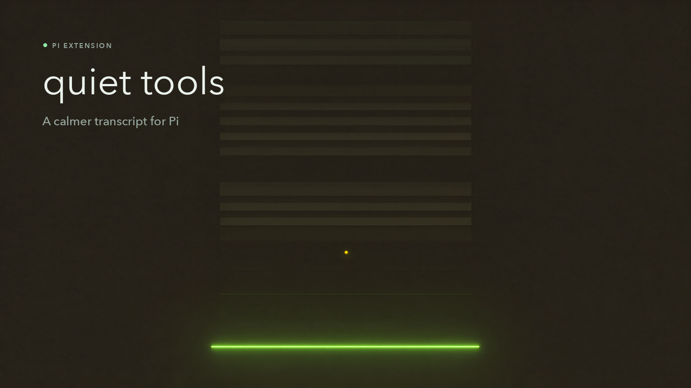

# Quiet Tools

**A small Pi extension for a calmer transcript.**

Long agent runs produce a lot of tool calls. Quiet Tools lets you keep the shape
of the work visible without letting every command and file dump take over the
screen. It changes rendering only — never the model, the tools, or their results.



## Four levels

| Level | What you see | Best for |
| --- | --- | --- |
| `name` | One dim line per call: `Reading src/index.ts...` | Watching a long run at a glance |
| `none` | No call content; Pi may reserve one spacer row. Errors still show | Deep focus, maximum quiet |
| `collapsed` | Pi's native tool rendering, with its own expand state | The normal transcript, with less noise |
| `full` | Pi's native rendering, forced open | Reviewing what a tool actually did |

Errors are never hidden. At every level, a failed tool leaves one compact red
line so a failure cannot scroll past unnoticed.

## Use

Cycle the level with **`ctrl+shift+o`**, or use the command:

```text
/quiet-tools              cycle
/quiet-tools name         one line per call
/quiet-tools none         no call content
/quiet-tools collapsed    native rendering
/quiet-tools full         native, open
```

The level is stored in `~/.pi/agent/quiet-tools.json` (or under
`PI_CODING_AGENT_DIR`), so it survives new sessions and `/reload`. If the state
file cannot be read or written, the extension falls back to in-memory state.

### Keep a tool native

Subagent progress cards stay at their native rendering by default because they
are the dashboard for background work. Change the exemption list with a
comma-separated environment variable:

```sh
QUIET_TOOLS_EXEMPT="subagent,my-custom-tool" pi
QUIET_TOOLS_EXEMPT="" pi        # quiet everything
```

## Install

From GitHub:

```sh
pi install git:github.com/JordiPosthumus/quiet-tools
```

From a local checkout:

```sh
pi install /path/to/quiet-tools
```

For a one-off development run:

```sh
pi --no-extensions --extension ./src/index.ts
```

Remove it with `pi remove` using the same source you installed.

## Why this exists

`ctrl+o` is good at opening one result. Quiet Tools is for the whole transcript:
it keeps a stable, scannable level across every tool call and repaints existing
rows when you switch. The implementation reads the level at paint time, so the
change is immediate rather than applying only to the next call.

The renderer delegates to each tool's own `renderCall`/`renderResult` for the
`collapsed` and `full` levels. Built-in tools, MCP tools, and other extensions
keep their native rendering; Quiet Tools only decides how much of it is shown.

## Compatibility and limits

- Built for the current Pi extension API. It uses `registerToolRenderer`,
  `renderShell: "self"`, `lastComponent`, and the component `invalidate()`
  contract. A future Pi renderer change may require an update.
- `ctrl+shift+o` is a global shortcut. If another extension or terminal captures
  it, use `/quiet-tools` instead.
- In `name` mode, the first 48 characters of a shell command are shown. That is
  useful for orientation, but it is **not** a secrecy layer.
- The state file is deliberately outside the project. Nothing is written to the
  repository you are working in.

## Privacy

Quiet Tools makes no network requests and has no runtime dependencies. It reads
and writes one local JSON file, and otherwise only formats text that Pi already
has.

## Development

Requires Node 22.22 or newer. The tests use Node's built-in test runner and
type stripping; there is no build step.

```sh
npm test
```

The repository is intentionally small:

```text
src/core.ts    modes, labels, error text
src/state.ts   local level persistence
src/index.ts   Pi renderer and commands
test/          unit tests
```

## License

MIT. See [LICENSE](LICENSE).

The cover art was generated locally with Qwen-Image-2.1. No cloud service was
used.
